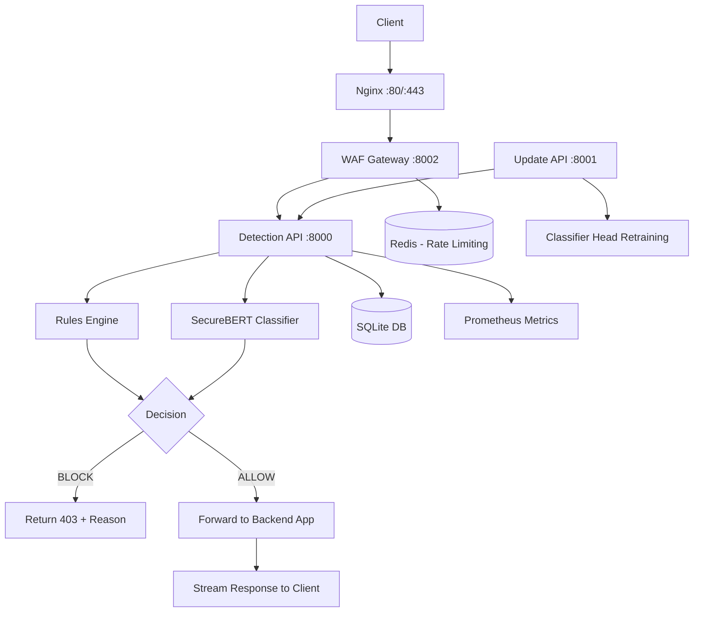

# Cyber-JEX WAF

[](https://github.com/CyberMaster000/cyber-jex-waf/actions/workflows/ci.yml)

A lightweight, AI-assisted Web Application Firewall designed with a focus on deterministic blocking, inspectable decisions, and safe inline enforcement. Cyber-JEX WAF combines high-confidence signature-based rules with a frozen transformer encoder and a trainable linear classifier head to provide layered request inspection for HTTP(S) traffic.

> **Note:** This project is an engineering prototype. Treat it as a testable reference implementation rather than a drop-in replacement for a fully hardened commercial WAF. See [Threat Model, Assumptions, Limitations, and Known Risks](#16-threat-model-assumptions-limitations-and-known-risks) for details.

## Table of Contents

- [1. Executive Summary](#1-executive-summary)
- [2. Problem Statement and Intended Use Cases](#2-problem-statement-and-intended-use-cases)
- [3. Product Capabilities and Verified Features](#3-product-capabilities-and-verified-features)
- [4. System Architecture](#4-system-architecture)
- [5. Request Inspection and Enforcement Workflow](#5-request-inspection-and-enforcement-workflow)
- [6. AI/ML Detection Architecture and Deterministic Rules](#6-aiml-detection-architecture-and-deterministic-rules)
- [7. Technology Stack](#7-technology-stack)
- [8. Installation and Local Development Setup](#8-installation-and-local-development-setup)
- [9. Configuration and Environment Variables](#9-configuration-and-environment-variables)
- [10. API Reference](#10-api-reference)
- [11. Deployment Architecture and Operational Requirements](#11-deployment-architecture-and-operational-requirements)
- [12. Security Controls](#12-security-controls)
- [13. Testing Strategy](#13-testing-strategy)
- [14. Performance, False Positives/Negatives and Resource Requirements](#14-performance-false-positivesnegatives-and-resource-requirements)
- [15. Data Handling, Privacy and Model Updates](#15-data-handling-privacy-and-model-updates)
- [16. Threat Model, Assumptions, Limitations, and Known Risks](#16-threat-model-assumptions-limitations-and-known-risks)
- [17. Monitoring, Troubleshooting and Maintenance](#17-monitoring-troubleshooting-and-maintenance)
- [18. Roadmap](#18-roadmap)
- [19. Contribution Guidelines](#19-contribution-guidelines)
- [20. License and Maintainer Information](#20-license-and-maintainer-information)

## 1. Executive Summary

Cyber-JEX WAF inspects incoming HTTP requests at the application layer and enforces an allow/block decision before forwarding traffic to a protected backend. Decisions are driven by a hybrid approach: deterministic exploit signatures take precedence, followed by a supervised classifier built on a frozen SecureBERT encoder with a logistic regression head. All actions are observable through a built-in dashboard, structured logs, audit trail, and Prometheus metrics.

## 2. Problem Statement and Intended Use Cases

**Intended Use Cases:**

- **Inline request filtering** for lab environments, internal apps or pre-production endpoints
- **Security observability** to inspect and reason about suspicious requests
- **Controlled experimentation** with rule-tuning and head-level retraining
- **Educational/research** into hybrid (rules + ML) WAF design with full transparency

**Out of Scope:** Direct replacement for a CDN/WAF edge DDoS mitigation product, full WAF rule-set parity with mature commercial offerings, or turnkey compliance certification.

## 3. Product Capabilities and Verified Features

| Capability | Status | Notes |
| :-- | :-- | :-- |
| Deterministic exploit rules | Implemented & tested | SQLi, XSS, Path Traversal, Command Injection, Log4Shell/JNDI, Spring4Shell, SSTI, XXE, SSRF, NoSQL injection, CRLF injection |
| Frozen SecureBERT encoder + logistic head | Implemented | `models/securebert_clf/` loaded at startup, hot-reloadable on head updates |
| Inline enforcement via gateway | Implemented | `src/api/gateway.py` blocks with HTTP `403` and proxies allowed requests via `httpx` streaming |
| Detection API with enforcement endpoint (`/check`) | Implemented | Returns `204 No Content` on allow, `403 Forbidden` on block |
| Live dashboard (`/history`) | Implemented | HTTP Basic auth, decision timeline, filters |
| Admin retraining of classifier head only | Implemented | `POST /retrain`, `GET /retrain/status`, atomic weight swap + backup |
| Benign sample ingestion for retraining | Implemented | `POST /add_benign_data` |
| Request context (`X-Request-ID`) | Implemented | Generated/sanitized and propagated across services |
| PII/secret redaction before persistence | Implemented | `src/utils/redaction.py` masks auth/cookies/tokens/passwords/PII |
| Privileged action audit trail | Implemented | `logs/audit.jsonl` with actor key fingerprint |
| Prometheus metrics | Implemented | `src/utils/metrics.py`, exposed via `/metrics` (token-gated optional) |
| Redis-backed fixed-window rate limiting | Implemented | With in-memory fallback on Redis failure |
| IP allow/block lists | Implemented | CIDR-based via `WAF_IP_ALLOWLIST` / `WAF_IP_BLOCKLIST` |
| Request size/path/header limits | Implemented | Enforced in detection API and gateway |
| TLS termination via Nginx | Implemented | HTTP->HTTPS redirect, HSTS, security headers |
| Structured JSON logging + rotation | Implemented | Configurable via env (`WAF_LOG_JSON`, `WAF_LOG_LEVEL`) |
| Health probes | Implemented | `/health`, `/health/live`, `/health/ready` |
| Unit tests | Implemented | `tests/` cover rules, redaction, IP filtering, API/auth/metrics |

## 4. System Architecture



**Component responsibilities:**

| Component | Purpose |
| :-- | :-- |
| `integration/nginx.conf` | TLS termination, edge rate-limiting, routing, security headers |
| `src/api/gateway.py` | Inline enforcement, body/path/header validation, backend proxying, IP filtering |
| `src/api/detection_api.py` | Scoring pipeline, dashboard, logs/stats/replay, admin operations |
| `src/api/update_api.py` | Head-only retraining, benign sample intake, admin-gated actions |
| `src/preprocessing/*` | Parsing, normalization, canonicalization, tokenization |
| `src/preprocessing/attack_rules.py` | Deterministic signatures + benign suppression logic |
| `src/models/transformer.py` | Encoder wrappers, head loading/reload, scoring |
| `src/models/head_trainer.py` | Head retraining logic |
| `src/storage/db.py` | Event persistence with pruning and redaction-aware storage |
| `src/utils/*` | Config, logging, metrics, audit, redaction, cache, ratelimit, request context |

## 5. Request Inspection and Enforcement Workflow

1. **Ingress** – Request hits Nginx (HTTPS). HTTP is redirected to HTTPS.
2. **Gateway validation** – Checks `Content-Length/Transfer-Encoding` consistency, header/body/path limits, IP allow/block, fixed-window rate-limit.
3. **Forward to detection** – Gateway calls detection service (`/check` or internal scoring path) with sanitized request data.
4. **Preprocessing** – Parse, canonicalize, normalize and tokenize the request.
5. **Rule evaluation** – Deterministic rules run first. If matched with high confidence, decision becomes `BLOCK` with `hard_rule:*` reasons.
6. **Model scoring** – If no rule match, the frozen SecureBERT encoder + logistic head produces a decision score.
7. **Benign guardrail** – For structurally benign traffic forms (JSON/XML/multipart/form/query with expected patterns), model-based blocks may be suppressed up to `suppression_max_score`.
8. **Decision & logging** – Result recorded with `request_id`, redacted context, latency, matched rules/reason. Audit entry created for privileged actions.
9. **Enforcement** – Gateway returns `403` on block (no backend contact) or streams backend response on allow with hop-by-hop headers stripped.

## 6. AI/ML Detection Architecture and Deterministic Rules

### Deterministic Rules
`src/preprocessing/attack_rules.py` contains explicit patterns for common injection classes. These are evaluated before model inference and are designed to be explainable and testable.

### AI/ML Component
- **Encoder:** SecureBERT (frozen). Weights reside under `models/securebert_clf/`. 
- **Head:** Logistic regression weights from `models/securebert_clf/classifier_weights.npz`. Only this head is retrained.
- **Type:** Supervised linear probe over frozen representations. It learns correlations from labelled samples; it is **not** an unsupervised "benign-only" zero-day detector.
- **Hot-reload:** On successful retraining, new head weights are written atomically and loaded without restarting the detection API.
- **Explainability:** Decisions include `reason` (`model:clean`, `model:anomaly`, `hard_rule:*`, `benign_suppressed:*`) for traceability.

## 7. Technology Stack

| Layer | Components |
| :-- | :-- |
| API Framework | FastAPI, Uvicorn |
| ML/Inference | PyTorch (CPU), Transformers, scikit-learn, NumPy |
| Proxy/Edge | Nginx (Alpine) |
| Cache/Rate-limit | Redis (optional with fallback) |
| Storage | SQLite (default) |
| Observability | Prometheus client, Loguru, custom audit logger |
| Containerization | Docker, Docker Compose |
| Testing | Python `unittest` |

## 8. Installation and Local Development Setup

### Prerequisites
- Python 3.11+
- `git` with [Git LFS](https://git-lfs.github.com/) installed
- Docker + Docker Compose (for containerized stack)
- CPU-only is supported by default

### Clone and fetch model weights
```bash
git clone https://github.com/CyberMaster000/cyber-jex-waf.git
cd cyber-jex-waf
git lfs install && git lfs pull
```

### Local venv setup
```bash
python3 -m venv venv
source venv/bin/activate
pip install --upgrade pip
pip install torch --index-url https://download.pytorch.org/whl/cpu
pip install -r requirements.txt
```

### Run services directly (development)
```bash
# Terminal 1: Detection API
source venv/bin/activate
uvicorn src.api.detection_api:app --host 127.0.0.1 --port 8080

# Terminal 2: Gateway (inline enforcement)
source venv/bin/activate
WAF_DETECTION_URL=http://127.0.0.1:8080 \
WAF_BACKEND_URL=http://127.0.0.1:5001 \
WAF_API_KEY=waf-key-dev-001 \
uvicorn src.api.gateway:app --host 127.0.0.1 --port 8002

# Terminal 3: Update API (optional for retraining)
source venv/bin/activate
uvicorn src.api.update_api:app --host 127.0.0.1 --port 8001
```

### Quick sanity checks
```bash
# Health
curl http://127.0.0.1:8080/health/ready

# Allow
curl -X POST http://127.0.0.1:8080/check \
  -H "X-API-Key: waf-key-dev-001" \
  -H "Content-Type: application/json" \
  -d '{"method":"GET","path":"/products?id=1","headers":{"User-Agent":"curl"},"body":""}' -i

# Block (SQLi)
curl -X POST http://127.0.0.1:8080/check \
  -H "X-API-Key: waf-key-dev-001" \
  -H "Content-Type: application/json" \
  -d '{"method":"GET","path":"/items?id=1%20UNION%20SELECT%20*%20FROM%20users","headers":{},"body":""}' -i
```

## 9. Configuration and Environment Variables

Configuration is defined in `config.yaml` with `${VAR:-default}` expansion. Use `.env` for secrets (never commit real secrets).

### Core variables

| Variable | Purpose | Default | Notes |
| :-- | :-- | :-- | :-- |
| `WAF_CONFIG_PATH` | Path to config.yaml | `config.yaml` | Override if needed |
| `WAF_API_KEY_1`, `WAF_API_KEY_2` | Keys for detection/read endpoints | dev keys in example | Use strong unique values |
| `WAF_ADMIN_KEY_1` | Admin key for `/threshold`, `/clear`, `/retrain`, `/add_benign_data` | dev key in example | Must be separate from read keys |
| `WAF_DASH_USER`, `WAF_DASH_PASSWORD` | HTTP Basic for `/history` | `sentinel` / `change-me` | Change before any shared use |
| `WAF_DETECTION_URL` | Gateway -> Detection API | - | Required for gateway |
| `WAF_BACKEND_URL` | Default backend to forward allowed traffic | - | Gateway config |
| `WAF_REDIS_URL` | Redis connection string | - | `redis://:pass@host:6379/0` if auth enabled |
| `REDIS_PASSWORD` | Redis auth password | - | Must match compose/URL |
| `WAF_RATE_LIMIT`, `WAF_RATE_WINDOW` | Fixed-window limits | `100` / `60` | Per client IP |
| `WAF_MAX_BODY_BYTES` | Max body size | `1048576` | 1 MiB |
| `WAF_METRICS_TOKEN` | Token for `/metrics` if enabled | empty | If set, require `X-Metrics-Token` |
| `WAF_LOG_JSON`, `WAF_LOG_LEVEL` | Logging format/level | `false` / `INFO` | Use JSON in centralized logging |
| `WAF_IP_ALLOWLIST`, `WAF_IP_BLOCKLIST` | Comma-separated CIDRs | empty | Emergency control |
| `WAF_HTTP_PORT`, `WAF_HTTPS_PORT` | Host ports for Nginx | `80` / `443` | Useful if ports already in use |

See `.env.example` for a complete reference.

## 10. API Reference

All routes below are implemented as verified. Auth requirements reflect current behavior.

### Detection & Enforcement
| Method | Path | Auth | Description |
| :-- | :-- | :-- | :-- |
| `POST` | `/detect` | `X-API-Key` | Score request, return full decision JSON with `reason`, `matched_rules`, `anomaly_score` |
| `POST` | `/detect/batch` | `X-API-Key` | Batch scoring |
| `POST` | `/check` | `X-API-Key` | Enforcement helper: `204 No Content` if allowed, `403 Forbidden` if blocked |

### Dashboard & Observability
| Method | Path | Auth | Description |
| :-- | :-- | :-- | :-- |
| `GET` | `/history` | HTTP Basic | Live dashboard UI |
| `GET` | `/stats` | `X-API-Key` | Aggregated counters by decision/reason |
| `GET` | `/logs` | `X-API-Key` | Paginated/filtered stored events (redacted) |
| `POST` | `/replay/{id}` | `X-API-Key` | Re-evaluate a previously stored event |
| `GET` | `/metrics` | Optional `X-Metrics-Token` | Prometheus exposition format |
| `GET` | `/health` | None | Basic liveness |
| `GET` | `/health/live` | None | Liveness probe |
| `GET` | `/health/ready` | None | Readiness (checks DB/model availability) |
| `GET` | `/version` | None | Service/version info |

### Admin / Retraining
| Method | Path | Auth | Description |
| :-- | :-- | :-- | :-- |
| `POST` | `/threshold` | Admin key | Update runtime threshold |
| `POST` | `/clear` | Admin key | Clear stored events (audit logged) |
| `POST` | `/retrain` | Admin key | Start head-only retraining (async) |
| `GET` | `/retrain/status` | Admin key | Retraining status/progress |
| `POST` | `/add_benign_data` | Admin key | Append benign samples for future retraining |

**Example `/detect` response:**

```json
{
  "request_id": "e7f3...",
  "is_anomaly": true,
  "decision": "BLOCKED",
  "reason": "hard_rule:sqli_union",
  "matched_rules": ["sqli_union"],
  "anomaly_score": 5.98,
  "threshold": -1.0,
  "latency_ms": 412.6,
  "model_version": "SecureBERT2.0-clf"
}
```

## 11. Deployment Architecture and Operational Requirements

### Docker (recommended for integrated stack)
```bash
git lfs install && git lfs pull
cp .env.example .env          # change every secret
./scripts/generate-self-signed.sh   # staging only; replace with real cert in prod
docker compose up -d --build
```

Access: `https://localhost/`. Dashboard: `https://localhost/history`. See `DEPLOYMENT.md` for full runbook.

### Services
| Service | Exposure | Role |
| :-- | :-- | :-- |
| `waf-nginx` | `80/443` | TLS, routing, edge limits |
| `waf-gateway` | internal | Inline enforcement + proxy |
| `waf-api` | internal | Detection, dashboard, observability |
| `waf-update-api` | internal | Admin retraining |
| `waf-redis` | internal | Rate limiting (with persistence) |
| `sample-app-*` | internal | Demo backends |

### Minimum guidance
- **CPU:** Sufficient for PyTorch CPU inference (expect 250–650ms uncached)
- **RAM:** >= 4–6 GB recommended for model + services
- **Disk:** >= 2–3 GB for repo, models, logs, DB
- **Network:** Behind controlled network in non-production; use proper ingress in staging/prod
- **TLS:** Do not use self-signed certs outside local testing

## 12. Security Controls

| Control | Implementation | Notes |
| :-- | :-- | :-- |
| Authentication (API) | `X-API-Key` header | Separate read/write/admin keys |
| Authentication (Dashboard) | HTTP Basic | Change defaults; consider OIDC later |
| Authorization | Role split (read vs admin) | Enforced per endpoint |
| Secrets | Env vars + `.env` (git-ignored) | Use external secret manager in prod |
| Request validation | Size/path/header/body limits | Prevents oversized/abusive requests |
| Redaction | `src/utils/redaction.py` | Applied before storage/logging |
| Audit logging | `src/utils/audit.py` | Privileged ops logged with key fingerprint |
| Rate limiting | Redis fixed-window + fallback | Per IP, configurable |
| IP filtering | CIDR allow/block | `WAF_IP_ALLOWLIST`/`WAF_IP_BLOCKLIST` |
| Security headers | Nginx + middleware | `X-Content-Type-Options`, `X-Frame-Options`, `Referrer-Policy`, CSP (as configured), HSTS |
| Fail-safe | Fail-closed on detection unavailability | Gateway returns `503` if detection unreachable |
| Request tracing | `X-Request-ID` | Correlation across logs/metrics |
| Metrics protection | Optional token | Restrict `/metrics` in production |

## 13. Testing Strategy

Tests use Python `unittest`. Run from repo root:

```bash
python -m unittest discover -s tests -v
```

| Test module | Focus |
| :-- | :-- |
| `tests/test_rules.py` | Deterministic rules, canonicalization, benign guard, rate-limiter behavior |
| `tests/test_redaction.py` | Header/query/body/XML/form redaction, key fingerprinting |
| `tests/test_ipfilter.py` | Allowlist/denylist CIDR logic |
| `tests/test_waf.py` | API auth, health, dashboard, detect/check, stats, request limits, redaction in logs, metrics (skipped if LFS pointers only) |

**Notes:** `test_waf` is skipped in environments where `models/securebert_clf/model.safetensors` is present only as a Git LFS pointer or missing. Docker build/tests expect model weights to be available where full API tests run.

## 14. Performance, False Positives/Negatives and Resource Requirements

| Metric | Observed/Expected | Notes |
| :-- | :-- | :-- |
| Uncached inference latency (CPU) | ~250–650 ms/request | Varies by length/complexity |
| Cached/duplicate requests | Significantly faster | Via internal caching where applicable |
| Throughput | Constrained by CPU + model size | Horizontal scaling and batching advised for higher load |
| False Positives (FP) | Possible on legitimate structured traffic | Mitigated by `is_structurally_benign` + `suppression_max_score`. Still needs app-specific tuning |
| False Negatives (FN) | Possible on novel/obfuscated variants | Deterministic rules cover known classes; model generalizes from training data only |

**Resource guidance:** 4–6 GB RAM minimum recommended for local stack. CPU-only supported.

## 15. Data Handling, Privacy and Model Updates

- **Redaction:** Sensitive headers/fields/tokens are masked before persisting events (`src/utils/redaction.py`). Stored events are truncated to ~1000 chars.
- **Audit:** Privileged operations write to `logs/audit.jsonl` with hashed actor key.
- **Retention:** SQLite events pruned periodically; logs follow rotation settings.
- **Retraining:** Only classifier head updated. Encoder remains frozen. Original head backed up (`classifier_weights.npz.bak`). Weights hot-reloaded.
- **Data sources:** Retraining can use stored benign samples + curated sets via API/scripts. Use only authorized/test data.
- **Privacy:** Avoid logging raw credentials/PII in plaintext. Review redaction coverage for your traffic before longer retention.

## 16. Threat Model, Assumptions, Limitations, and Known Risks

### Assumptions
- Model weights present under `models/securebert_clf/` (pulled via Git LFS)
- Redis reachable for distributed rate-limiting or acceptable with fallback
- TLS terminated correctly at edge in deployment
- API keys rotated from defaults

### Limitations
- **Not zero-day guaranteed:** Supervised model + known signatures; novel attack classes may slip or require retraining
- **CPU-bound latency:** May be too high for some high-throughput synchronous paths without optimization
- **Single-node oriented:** SQLite + single gateway/detection replicas suit small-scale use
- **Self-signed TLS by default:** Must replace with trusted certs
- **Limited edge coverage:** No built-in WAF-wide virtual patching for all CVEs
- **Partial backend routing:** Primarily single-backend oriented in current config

### Known Risks
- **False positives** causing legitimate traffic blocks
- **Log leakage** if redaction/retention misconfigured
- **Secret exposure** if defaults not changed
- **Model staleness** without periodic evaluation/retraining
- **Bypass via obfuscation** if rules/gates not tuned to app

## 17. Monitoring, Troubleshooting and Maintenance

### Monitoring
- `/metrics` – request counts by decision/method/service, blocked reasons, latency histograms
- `/health/ready` – startup/model readiness
- `logs/waf.log` – application logs
- `logs/audit.jsonl` – privileged actions
- Dashboard `/history` – recent decisions

### Troubleshooting
| Issue | Check | Fix |
| :-- | :-- | :-- |
| Model fails to load | `logs/waf.log`, `/health/ready` | Ensure Git LFS pulled weights; check `models/securebert_clf/` |
| Gateway returns 503 | Detection API reachability | Verify `WAF_DETECTION_URL`, network, detection healthy |
| Everything blocked | Threshold/rules | Check `config.yaml` `threshold`, benign guard, recent rules |
| Redis errors in logs | Redis connectivity/auth | Verify `WAF_REDIS_URL`/`REDIS_PASSWORD`; fallback is in-memory |
| Permission issues in Docker | Volume ownership | Match container UID or `chown` mounted dirs |
| TLS errors | `certs/` missing/invalid | Run `scripts/generate-self-signed.sh` or provide valid certs |

### Maintenance
- Rotate API keys, admin keys, dashboard creds regularly
- Backup `data/`, `logs/`, `models/` as appropriate
- Evaluate FPs on real traffic and tune
- Retrain head with authorized samples when drift observed
- Keep dependencies updated with security review
- Review audit logs periodically

## 18. Roadmap

| Item | Priority | Status |
| :-- | :-- | :-- |
| OWASP-aligned rule mapping + test corpus | High | Planned |
| ONNX runtime + quantization for faster CPU inference | High | Planned |
| Path/multi-backend routing improvements | High | Partial/Planned |
| PostgreSQL support for HA | High | Planned |
| Centralized logging/SIEM integration | High | Planned |
| OIDC/SSO for dashboard | High | Planned |
| SBOM, image signing, provenance | Medium | Planned |
| Evasion regression suite | Medium | Planned |
| Grafana dashboards/examples | Medium | Planned |

## 19. Contribution Guidelines

1. Fork the repository
2. Create a feature branch: `git checkout -b feature/your-change`
3. Follow existing code style and module structure
4. Add/update tests for new behavior
5. Run `python -m unittest discover -s tests -v` before submitting
6. Keep changes focused and avoid committing secrets, logs, or local DBs
7. Submit a clear PR describing rationale, testing done, and impact

## 20. License and Maintainer Information

- **Maintainer:** Nikhil Gupta
- **Repository:** [https://github.com/CyberMaster000/cyber-jex-waf](https://github.com/CyberMaster000/cyber-jex-waf)
- **License:** Refer to repository for license terms if present. If unspecified, use with appropriate caution in non-personal contexts.

**Important:** The model weights are distributed via Git LFS. After cloning, run `git lfs pull` to fetch them. Always change default credentials before any shared or network-exposed deployment.
